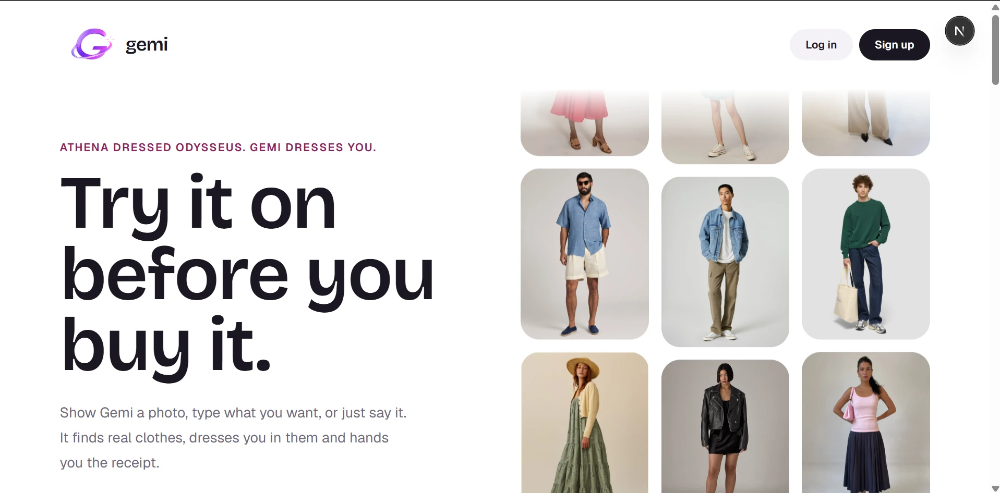
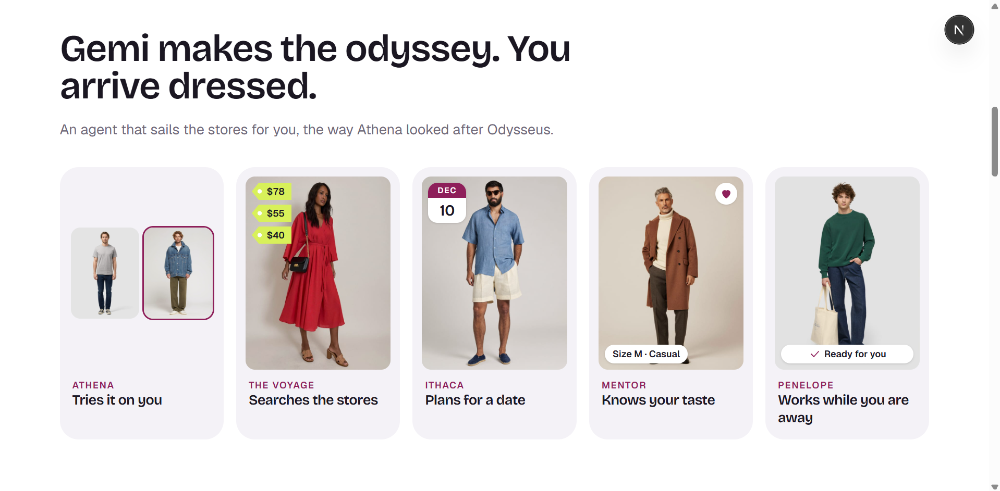
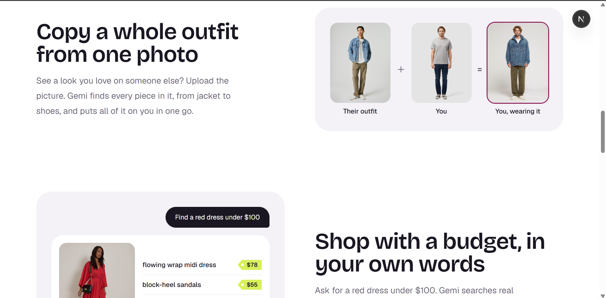
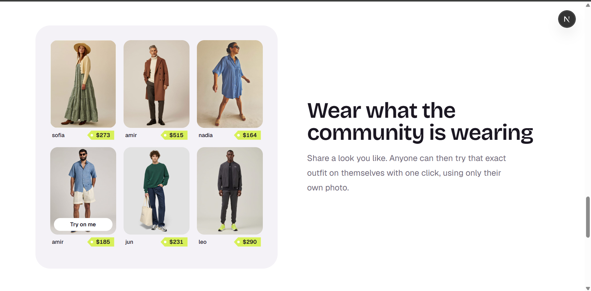
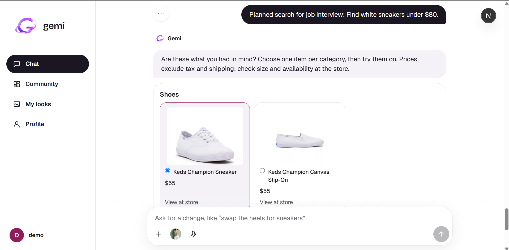
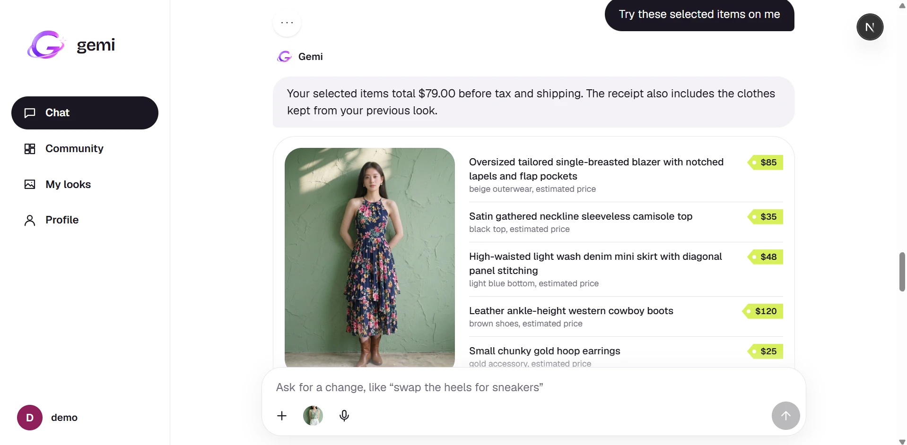
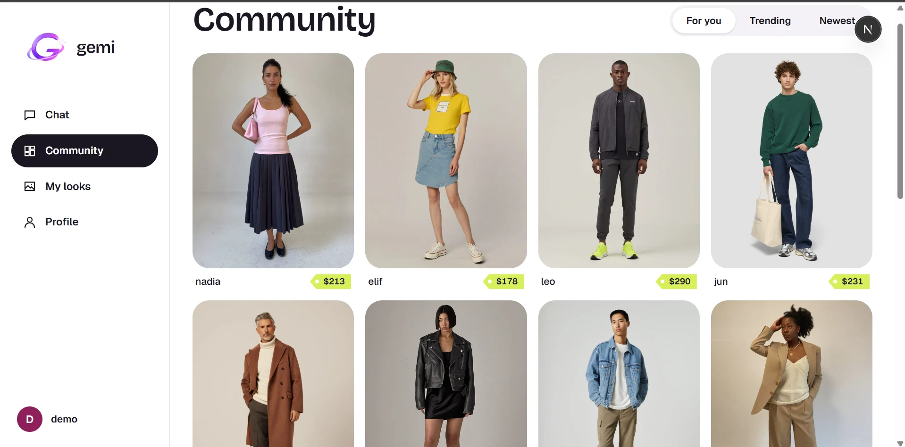
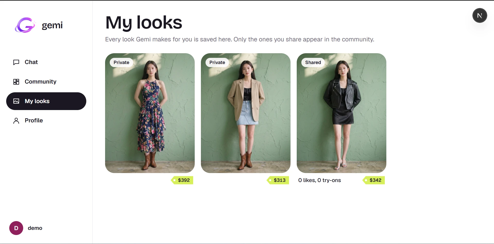

<p align="center"></p>

# Gemi

## The problem

Buying clothes online is guesswork. You cannot see how a piece looks on you, you search many stores to stay inside a budget, and every store asks for your size and style again. Returns cost shoppers and stores time and money.

## The solution

Gemi is an autonomous AI stylist agent. You give it a photo of yourself and a request in text or voice; it does the rest on its own:

- **Tries clothes on you.** From reference photos, a shopping result or a look someone shared. It changes only the pieces you asked for and keeps the rest of your outfit.
- **Searches for clothes.** It searches the web, offers up to three real products per category with photo, price and store link, and keeps the total inside your budget.
- **Plans.** Save a request for a date (for example an outfit for an event) and Gemi runs it that day.
- **Knows your preferences.** It uses your saved sizes, department and style, and learns your taste from the looks you like to rank the community feed and guide shopping.
- **Works in the background.** Every request is a job in the database. Close the tab and come back to the result and the chat history.

Built at **HackUTA 2026** (November 14–15, 2026) during the 24-hour hacking window.

## Theme: Homer's Odyssey

Getting dressed online is a long voyage through dozens of stores. Gemi makes that odyssey for you, the way Athena looked after Odysseus. Each thing the agent does on its own maps to a part of the story:

| In the Odyssey | In Gemi |
| --- | --- |
| **Athena** changes how Odysseus looks before every big moment | Try-on: the clothes appear on your own photo |
| **The voyage** from island to island | Shopping search: store to store, inside your budget |
| **Ithaca**, the destination | Plans: an outfit ready for a date |
| **Mentor**, the form Athena takes to guide the family | Preferences: Gemi remembers your sizes, style and likes |
| **Penelope** keeps her loom going while Odysseus is away | Background jobs: Gemi works after you close the tab |

The studio also offers five one-click Odyssey looks (Odysseus, Penelope, Athena, Circe, Ithaca). Each is a real request: the agent searches real products, keeps the budget and tries the outfit on you.

## Tools used

| Tool | How we used it |
| --- | --- |
| **Claude Code** | Main coding agent. Wrote most of the app: the model pipeline, database schema, auth, jobs, screens and tests. |
| **OpenAI Codex** | Second coding agent, for a review-and-fix pass (branch `codex/hackathon-styling-fixes`, merged as PR #1). |
| **Gemini models via OpenRouter** | Most model calls go through OpenRouter: `gemini-3.8-flash` for understanding requests, reading garments and web shopping search, and `gemini-nano-banana-2.1` for try-on images and edits. |
| **Gemini API** (`@google/genai`) | `gemini-embedding-2` for look embeddings, and the fallback when an OpenRouter call fails. |
| **Tiger Data** (Timescale Postgres) | The only database: users, looks, jobs, plans. A hypertable stores look events; `pgvector` powers the For you ranking. |
| **Next.js 16**, **React 19**, **Tailwind CSS 4** | App, API routes and styling. |
| **sharp**, **pg** | Image resizing and the database driver. |
| **Vercel Cron** | Daily trigger for saved plans. |

## Run it locally

Requires Node 24 or newer.

1. Install packages:

   ```bash
   npm install
   ```

2. Create `.env.local` (it is git-ignored; never commit keys):

   ```
   OPENROUTER_API_KEY=
   GEMINI_API_KEY=
   DATABASE_URL=
   ```

3. Create the tables:

   ```bash
   node --env-file=.env.local scripts/setup-db.ts
   ```

4. Start the app and open http://localhost:3000:

   ```bash
   npm run dev
   ```

## Screenshots

**Landing page**



**The Odyssey theme: five things the agent does on its own**



**Copy a whole outfit from one photo, and shop with a budget**



**Wear what the community is wearing**



**The agent runs a planned search and offers real products**



**Try-on result with the receipt**



**Community feed**



**My looks**



## License

[MIT](LICENSE)
